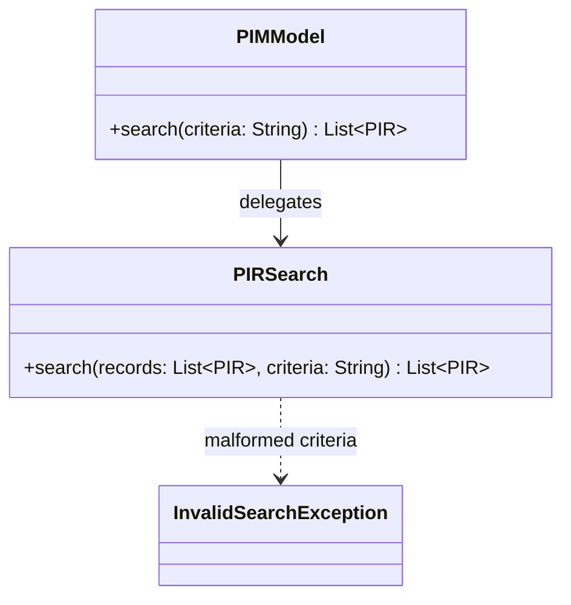

# B Search Design Contribution

This document specifies the Java search module for US7 (FR-07 and FR-08). It
can be merged into the group's design document. Later search code must follow
this contract. The CLI parses the command line and passes one criteria string
here; this module parses that string, matches PIRs, and returns the hits.

Search reads records only through `PIMModel.listRecords()`, `PIR.getType()`,
and the type-specific getters. It does not use the collection's internal map,
and it does not add, update, or delete records.

## Structure



`PIRSearch` is the search implementation. `PIMModel.search` is a thin wrapper
so the CLI can call the model without building a record list itself:

```java
public List<PIR> search(String criteria) {
    return PIRSearch.search(listRecords(), criteria);
}
```

```java
public final class PIRSearch {
    public static List<PIR> search(List<PIR> records, String criteria)
}
```

`search` returns a new unmodifiable list in the same order as `records`. A
record appears at most once. No match returns an empty list. It does not throw
`RecordNotFoundException`.

## Criteria language

Keywords, field names, and type names are case-insensitive. Text matching is
also case-insensitive. A criteria string is a sequence of tokens separated by
whitespace. Text values and date/time values are double-quoted and may contain
spaces. A quoted value cannot contain a double quote. `!` may sit against the
next token (`!type`) or stand alone (`! type`).

```text
search     = or
or         = and { "||" and }
and        = not { "&&" not }
not        = "!" not | primary
primary    = "(" search ")" | comparison
comparison = "type" "=" typeName
           | textField "contains" quoted
           | timeField ( "<" | ">" | "=" ) quoted
typeName   = "note" | "task" | "event" | "contact"
textField  = "text" | "description" | "name" | "address" | "mobile"
timeField  = "deadline" | "start" | "alarm"
quoted     = '"' characters '"'
```

`!` binds tighter than `&&`, and `&&` binds tighter than `||`. Parentheses
override that order. For example, `type = task || type = event && description
contains "report"` means `type = task || (type = event && description contains
"report")`.

Date/time values use exactly `yyyy-MM-dd HH:mm` inside quotes. `LocalDateTime`
has no timezone. This is the format the CLI and search module both use.

### Examples

```text
type = task
text contains "milk"
deadline < "2026-10-02 09:00"
type = event && start > "2026-10-01 00:00"
(type = task || type = event) && description contains "report"
! type = note
```

## Field mapping

| Criterion name | Record types | Getter |
|---|---|---|
| `type` | all | `getType()` |
| `text` | Note | `getText()` |
| `description` | Task, Event | `getDescription()` |
| `name` | Contact | `getName()` |
| `address` | Contact | `getAddress()` |
| `mobile` | Contact | `getMobileNumber()` |
| `deadline` | Task | `getDeadline()` |
| `start` | Event | `getStartTime()` |
| `alarm` | Event | `getAlarmTime()` |

`contains` is true when the field value contains the quoted text, ignoring
case. `<`, `>`, and `=` compare `LocalDateTime` values. A comparison against a
field that the record does not have is false for that record. It is not an
error. `deadline < "2026-10-02 09:00"` therefore selects only tasks before that
instant.

## Exceptions

`InvalidSearchException` extends `IllegalArgumentException`. `search` throws it
when the criteria string is malformed, before it returns any list. Malformed
criteria include:

- `records` or `criteria` is null
- `criteria` is empty or whitespace
- an unknown field or type name
- a quoted value that is empty or not closed
- a date/time that is not `yyyy-MM-dd HH:mm`
- an operator with a missing operand
- leftover tokens after a complete expression

Search does not modify the model. A thrown `InvalidSearchException` leaves
every stored PIR unchanged.

## Integration contract

- **A PIR core:** call `listRecords()` and read fields with public getters.
  `PIMModel.search` is the only addition on A's class.
- **D CLI:** accept one search command, pass its criteria string to
  `PIMModel.search`, and print the returned records. Catch
  `InvalidSearchException` at the controller boundary and show `getMessage()`.
  Do not treat an empty list as an error.

## Verification

`src/test/java/model/SearchTest.java` is a self-contained `main`, same style as
`ModelCoreTest`. `run_tests.ps1` runs it after the core tests. The tests cover
type filters, each text field, case-insensitive contains, all three time
relations, missing-field comparisons, `&&` / `||` / `!` with precedence and
parentheses, insertion order, an empty result, malformed criteria, and that a
failed search does not change the model.
