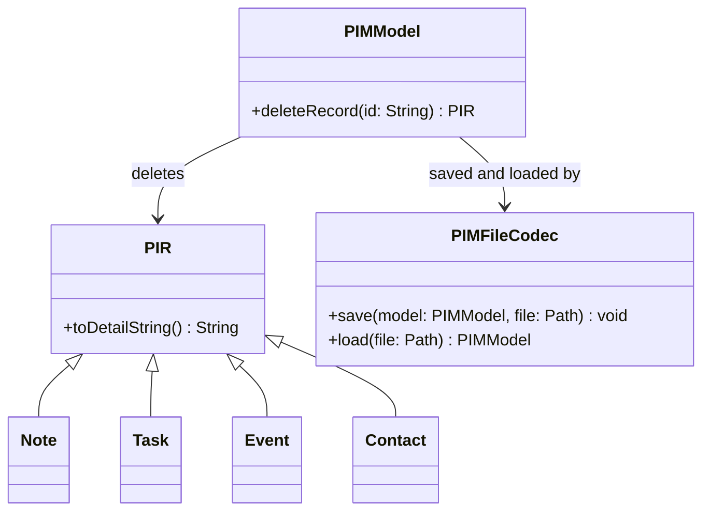

# C Persistence and Record Operations Design Contribution

This document specifies the Java record-operations and persistence module for
US8 (print), US9 (delete), US10 (save), and US11 (load) (FR-09 through FR-12).
It can be merged into the group's design document. The CLI calls only the
public model API; all formatting and serialization live in the `model` package
so that Deliverable 4's unit tests and line-coverage report can exercise them.

## Structure



`PIR.toDetailString()` is implemented by each of the four PIR types and returns
a single fixed-format string containing the ID, the type, and every stored
field. `PIMModel.deleteRecord(String id)` removes a record by ID and throws
`RecordNotFoundException` when the ID is unknown. `PIMFileCodec` serializes
every record returned by `PIMModel.listRecords()` and reconstructs a
`PIMModel` through `new PIMModel(decodedRecords)`.

## Public methods and exceptions

| Method | Purpose | Possible exceptions |
|---|---|---|
| `PIR.toDetailString()` | Fixed-format detail output (US8) | none |
| `PIMModel.deleteRecord(String id)` | Remove one PIR by ID (US9) | `RecordNotFoundException` |
| `PIMFileCodec.save(PIMModel, Path)` | Write all PIRs to a .pim file (US10) | `IOException` |
| `PIMFileCodec.load(Path)` | Read PIRs from a .pim file (US11) | `IOException`, `InvalidRecordException`, `DuplicateRecordException` |

## .pim file format

One block per record, blank line between blocks. Free-text fields
(`text`, `description`, `name`, `address`, `mobile`) are Base64-encoded so
newlines, Unicode, and `=` characters never break parsing. Time fields use
exactly `yyyy-MM-dd HH:mm` (the same `ResolverStyle.STRICT` format as the
search module). Record order equals insertion order.

```text
type=NOTE
id=550e8400-e29b-41d4-a716-446655440000
text=QnV5IG1pbGs=

type=TASK
id=...
description=...
deadline=2026-10-02 09:00
```

| Type | Free-text fields (Base64) | Time fields |
|---|---|---|
| NOTE | text | — |
| TASK | description | deadline |
| EVENT | description | start, alarm |
| CONTACT | name, address, mobile | — |

An empty file loads as an empty model. Unknown type, missing required field,
invalid time, and duplicate ID each produce a clear error without changing
records already in memory.

## Integration contract

- **A PIR core:** persistence builds on `PIMModel.listRecords()`, the
  `PIMModel(Collection)` constructor, and the type-specific getters.
- **B Search:** both modules use the same time format `yyyy-MM-dd HH:mm`.
- **D CLI:** call `getRecord(id).toDetailString()` for one-record print,
  iterate `listRecords()` for all-record print, call `deleteRecord(id)` for
  delete, and call `PIMFileCodec.save` / `PIMFileCodec.load` for file commands.
  Catch model exceptions at the controller boundary and show readable errors.

## Verification

`src/test/java/model/PersistenceTest.java` is a self-contained `main`, same
style as `ModelCoreTest` and `SearchTest`. It covers print output for all four
types, deletion (existing, missing, re-add), save/load round trips including
special characters and Chinese text, empty-file loading, missing-file errors,
and all malformed-file branches.
