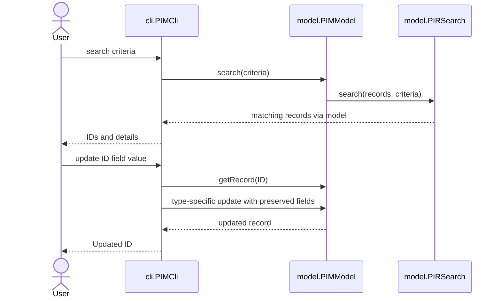

# D: CLI and integration

## Developer guide
Developed and tested on Windows with Temurin JDK 21.0.3; sources target Java 8. This revision is verified on JDK 21.0.3; a Java 8 runtime was not re-tested for this revision.
Only standard Java libraries are used. Open the project folder in an IDE with Java support (for example IntelliJ IDEA), mark src/main/java as sources and src/test/java as tests, and run or debug cli.PIMCli.main.
From PowerShell in the repository root:

```powershell
.\run.ps1
.\run_d_tests.ps1
```
The first command compiles and launches the interactive app. The second compiles all sources and runs A/B/C tests plus CLI integration checks. No Maven or downloaded runtime dependencies are needed.

## User guide
Enter commands at `pim>`, not directly in PowerShell. Commands and type names are case-insensitive. Quote arguments containing spaces with double quotes. Within quoted command arguments, two double quotes represent one literal quote. Backslashes are literal, including Windows paths. Dates use exactly `yyyy-MM-dd HH:mm`, with valid calendar dates and 24-hour times. Times have no timezone; model detail output uses ISO `T` between date and time.

```text
create note "Buy milk"
create task "Finish report" "2026-11-20 20:00"
create event "Group meeting" "2026-11-10 15:00" "2026-11-10 14:30"
create contact Alice "Hong Kong" 12345678
print all
search (type = task || type = event) && description contains "report"
save "my records.pim"
load "my records.pim"
help
quit
```
Creation prints a unique ID. The commands below accept the full ID or any unique prefix of it (8 characters usually suffice):

```text
print ID
update ID text "New note text"
update ID description "Revised task" deadline "2026-11-21 18:00"
delete ID
```
Updates accept one or more field/value pairs and preserve unspecified fields, ID and type. Allowed fields: note: text; task: description, deadline; event: description, start, alarm; contact: name, address, mobile. Duplicate or inappropriate fields are rejected. Required text cannot be blank.

Print displays the ID, type and every stored field. Results start with the count; zero results is normal. Event alarms are stored data, not background notifications.

IDs must be nonblank. Both an empty ID (two quotes) and an ID containing only whitespace are rejected by print, update and delete, even when only one record exists. A nonempty prefix that matches several records is rejected; enter more characters or the full ID.

### Complete search reference

Keywords, field names, and type names are case-insensitive. Text matching is
also case-insensitive. A criteria string is a sequence of tokens separated by
whitespace. Text values and date/time values are double-quoted and may contain
spaces. A quoted value cannot contain a double quote. `!` may sit against the
next token (`!type`) or stand alone (`! type`).

```text
expression = or
or         = and { "||" and }
and        = not { "&&" not }
not        = "!" not | primary
primary    = "(" expression ")" | comparison
comparison = "type" "=" typeName
           | textField "contains" quoted
           | timeField ( "<" | ">" | "=" ) quoted
typeName   = "note" | "task" | "event" | "contact"
textField  = "text" | "description" | "name" | "address" | "mobile"
timeField  = "deadline" | "start" | "alarm"
quoted     = '"' characters '"'
```

`!` binds tighter than `&&`, and `&&` binds tighter than `||`. Parentheses
override that order. For example, `type = task || type = event && description
contains "report"` means `type = task || (type = event && description contains
"report")`.

Date/time values use exactly `yyyy-MM-dd HH:mm` inside quotes. `LocalDateTime`
has no timezone. This is the format the CLI and search module both use.

### Search examples

```text
type = task
text contains "milk"
deadline < "2026-10-02 09:00"
type = event && start > "2026-10-01 00:00"
(type = task || type = event) && description contains "report"
! type = note
```

## Field mapping

| Criterion name | Record types |
|---|---|
| `type` | all |
| `text` | Note |
| `description` | Task, Event |
| `name` | Contact |
| `address` | Contact |
| `mobile` | Contact |
| `deadline` | Task |
| `start` | Event |
| `alarm` | Event |

`contains` is true when the field value contains the quoted text, ignoring
case. `<`, `>`, and `=` compare `LocalDateTime` values. A comparison against a
field that the record does not have is false for that record. It is not an
error. `deadline < "2026-10-02 09:00"` therefore selects only tasks before that
instant.


### Search errors and output
Use `search CRITERIA` at the prompt; the grammar above describes CRITERIA. Examples above omit the leading search command. Put spaces around comparison and binary logical operators; parentheses and ! may touch adjacent tokens. Search quoted values cannot contain double quotes (the doubled-quote rule for create/update does not apply to search). Empty quoted search values, invalid dates, unknown fields/types, missing operands and unclosed parentheses print Error: and preserve all records. An otherwise valid criterion with no matches prints 0 record(s). Each match shows the complete record ID, type and fields, in insertion order, once per record.

```text
search type = contact && address contains "Hong Kong"
search deadline < "2026-11-20 20:00"
search !(type = note || type = contact)
```

Save stages all bytes in the destination directory, then atomically replaces the named .pim file. If staging or replacement fails, the old file is preserved; a filesystem without atomic replacement support reports an error instead of falling back to an unsafe overwrite. The destination directory must be writable. This does not guarantee recovery from power loss or disk corruption. Load replaces the entire current collection only after a successful read. Save first if current changes are needed. Relative paths resolve from the directory where you launched the program. Quit, exit and end-of-input do not automatically save. Invalid commands, arguments, dates, IDs and files print `Error:` and allow the next command; failed updates and failed loads preserve current data.

## Design
`cli.PIMCli` is the terminal view/controller. Its constructor accepts a PrintWriter; `run(BufferedReader)` drives the loop and may throw IOException for terminal read failures; `execute(String)` returns false for exit and handles expected command errors. The existing model owns all business rules, search and persistence. No A/B/C model files were changed.



## Validation and scope
D tests cover all four creation commands, partial note update, compound search, print, delete, save/load round trip, invalid updates, invalid dates and quoting, missing IDs, failed-load preservation, filename extension and EOF/quit. Existing model tests remain the authoritative domain tests. These are integration checks, not a new model coverage measurement. Existing coverage reports must be regenerated for the final submission as appropriate.
This Markdown file is development documentation; the course's final manuals/design documents still need DOC/DOCX/PDF export and group review. Demo video, presentation and honour declaration are separate group deliverables. Acknowledge AI assistance for this CLI, tests and documentation in the group declaration.
