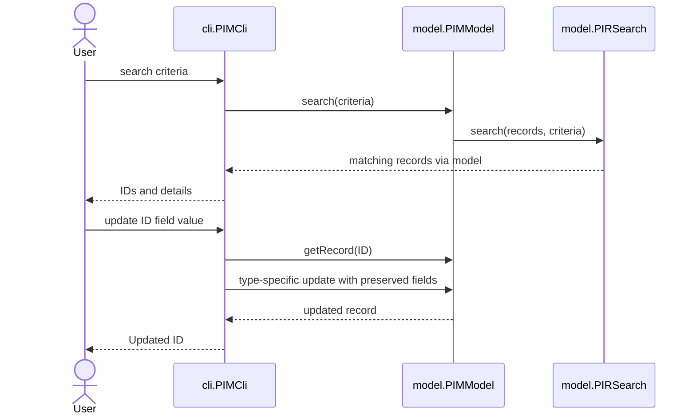

# D: CLI and integration

## Developer guide
Developed and tested on Windows with Temurin JDK 21.0.3; sources target Java 8.
Only standard Java libraries are used. Open the project folder in an IDE with Java support (for example IntelliJ IDEA), mark src/main/java as sources and src/test/java as tests, and run or debug cli.PIMCli.main.
From PowerShell in the repository root:

```powershell
.\run.ps1
.\run_d_tests.ps1
```
The first command compiles and launches the interactive app. The second compiles all sources and runs A/B/C tests plus CLI integration checks. No Maven or downloaded runtime dependencies are needed.

## User guide
Enter commands at `pim>`, not directly in PowerShell. Commands and type names are case-insensitive. Quote arguments containing spaces with double quotes. Within quoted command arguments, two double quotes represent one literal quote. Backslashes are literal, including Windows paths. Dates use exactly `yyyy-MM-dd HH:mm`, with valid calendar dates and 24-hour times. Times have no timezone; model detail output uses ISO `T` between date and time.

```text
create note "Buy milk"
create task "Finish report" "2026-11-20 20:00"
create event "Group meeting" "2026-11-10 15:00" "2026-11-10 14:30"
create contact Alice "Hong Kong" 12345678
print all
search (type = task || type = event) && description contains "report"
save "my records.pim"
load "my records.pim"
help
quit
```
Creation prints a unique ID. Copy the full ID to use the following commands (replace ID):

```text
print ID
update ID text "New note text"
update ID description "Revised task" deadline "2026-11-21 18:00"
delete ID
```
Updates accept one or more field/value pairs and preserve unspecified fields, ID and type. Allowed fields: note: text; task: description, deadline; event: description, start, alarm; contact: name, address, mobile. Duplicate or inappropriate fields are rejected. Required text cannot be blank.

Search passes the expression unchanged to B's parser. See B_search_design.md for the complete grammar: type equality, case-insensitive text contains, time comparisons < > =, parentheses, &&, ||, !. Search quoted values cannot contain double quotes. Results show a count and details; zero results is normal. Print displays all stored fields. Event alarms are stored data, not background notifications.

Save overwrites the named .pim file. Load replaces the entire current collection only after a successful read. Save first if current changes are needed. Relative paths resolve from the directory where you launched the program. Quit, exit and end-of-input do not automatically save. Invalid commands, arguments, dates, IDs and files print `Error:` and allow the next command; failed updates and failed loads preserve current data.

## Design
`cli.PIMCli` is the terminal view/controller. Its constructor accepts a PrintWriter; `run(BufferedReader)` drives the loop and may throw IOException for terminal read failures; `execute(String)` returns false for exit and handles expected command errors. The existing model owns all business rules, search and persistence. No A/B/C model files were changed.



## Validation and scope
D tests cover all four creation commands, partial note update, compound search, print, delete, save/load round trip, invalid updates, invalid dates and quoting, missing IDs, failed-load preservation, filename extension and EOF/quit. Existing model tests remain the authoritative domain tests. These are integration checks, not a new model coverage measurement. Existing coverage reports must be regenerated for the final submission as appropriate.
This Markdown file is development documentation; the course's final manuals/design documents still need DOC/DOCX/PDF export and group review. Demo video, presentation and honour declaration are separate group deliverables. Acknowledge AI assistance for this CLI, tests and documentation in the group declaration.
